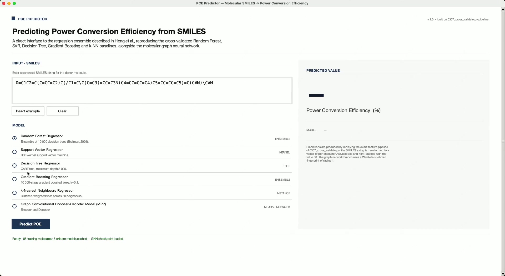
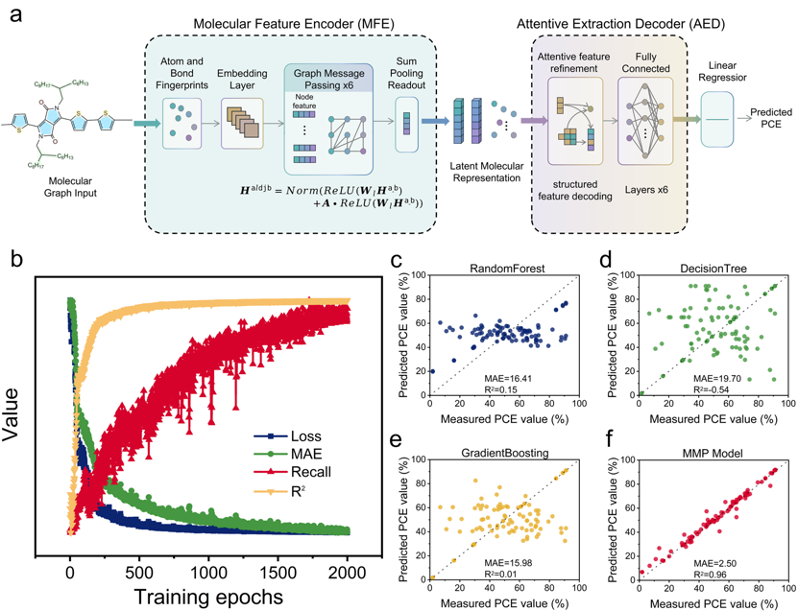

# Molecular Photothermal Conversion Efficiency Prediction

This package predicts photothermal conversion efficiency (PCE, %) from a molecular SMILES string. It includes the MPP graph neural network, an archived checkpoint, a labeled reference dataset, and five baseline regressors. The command-line tools support prediction, evaluation, and training.

[Installation](#installation) · [First prediction](#predict-pce) · [Figure 1 and checkpoint results](#graph-model-and-checkpoint) · [PDPP3T case study](#pdpp3t-case-study)

## Demo

The recording shows how to enter a SMILES string and select a model in the application. The interface in the recording labels PCE as "Power Conversion Efficiency." The target documented for this project is **photothermal conversion efficiency**. The commands below run the model from the terminal.

<video controls width="900" poster="assets/demo_preview.jpg">
  <source src="assets/demo.mp4" type="video/mp4">
</video>

[](assets/demo.mp4)

[Open the recording](assets/demo.mp4)

## Installation

From the extracted project directory, create a Python 3.10–3.13 virtual environment and install the dependencies.

```bash
python3 -m venv .venv
source .venv/bin/activate
python -m pip install --upgrade pip
python -m pip install -r requirements.txt
```

For CUDA, install a PyTorch build compatible with your GPU driver. The default `--device auto` selects CUDA, Apple MPS, or CPU in that order. Use `--device cpu`, `--device cuda:0`, or `--device mps` to select a device explicitly.

The CPU examples below were verified on Apple silicon with macOS 15.5, Python 3.13.13, PyTorch 2.12.0, RDKit 2026.3.2, NumPy 2.4.6, and scikit-learn 1.9.0. The archive includes the weights and reference data needed for offline prediction after installation.

## Predict PCE

Run this example on the CPU to check the installation and archived checkpoint.

```bash
python predict.py --device cpu --smiles 'O=C1C2=C(C=CC=C2)C(/C1=C\C(C=C3)=CC=C3N(C4=CC=CC=C4)C5=CC=CC=C5)=C(C#N)\C#N'
```

For batch prediction, supply one SMILES per line, without a header or PCE labels. This example takes two structures from the bundled data and writes the predictions to a CSV file.

```bash
awk 'NR <= 2 {print $1}' data/smiles_pce.txt > molecules.smi
python predict.py --device cpu --input molecules.smi --output outputs/predictions.csv
```

The model takes molecular structure as its only input, so the same SMILES receives the same estimate across different formulations and irradiation conditions.

The default `--unknown-policy error` reports a local feature missing from the checkpoint vocabulary. With `--unknown-policy zero`, the model uses index 0 for each missing feature and reports the number of substitutions in `unknown_features`. A count of zero means that every feature matched the vocabulary.

## Reference data

Each line in `data/smiles_pce.txt` contains a SMILES string and a measured PCE percentage separated by whitespace, with no header.

The original file contains 96 rows. Ten repeat an identical SMILES string and label, and ten contain disconnected fragments. The loader checks that each structure parses in RDKit, each label is a finite number from 0 to 100, and repeated SMILES strings have consistent labels.

## Graph model and checkpoint



**Figure 1. Predicting photothermal conversion efficiency from polymer structure.** Panel **a** shows how atom and bond fingerprints are combined into a molecular representation for PCE regression. Panel **b** tracks loss, MAE, recall, and R² during training. The falling loss shows a closer fit to the training data. Panels **c–f** compare predicted and measured PCE for random forest, decision tree, gradient boosting, and the graph model. 

## Evaluate a checkpoint

Supply a labeled file in the same two-column format as the reference data.

```bash
python evaluate.py --data path/to/held_out.txt
```

The command reports the sample count, MAE, RMSE, R², and the total number of unknown-feature substitutions. To reproduce the reference-set calculation, use `--data data/smiles_pce.txt --device cpu`.

## Train a model

```bash
python train.py --data data/smiles_pce.txt --output checkpoints/trained_mpp.pth \
  --epochs 1000 --batch-size 16 --device auto
```

Training uses a seeded random validation split, mean squared error, the Adam optimizer, and early stopping. The script builds the fingerprint vocabulary from all supplied structures before splitting the records. For an independent evaluation, set aside test structures before passing data to `train.py`. The saved checkpoint contains the weights with the lowest validation loss, model settings, fingerprint vocabulary, and a training summary. Pass `--checkpoint checkpoints/trained_mpp.pth` to the prediction or evaluation command to use it.

| Option | Default | Meaning |
|---|---:|---|
| `--learning-rate` | `1e-4` | Adam learning rate |
| `--validation-fraction` | `0.1` | Fraction of records used for validation |
| `--patience` | `100` | Epochs without improvement before stopping |
| `--seed` | `1234` | Random seed for splitting and training |
| `--embedding-dim` | `50` | Fingerprint embedding dimension |
| `--hidden-layers` | `6` | Graph message-passing layers |
| `--output-layers` | `6` | Hidden layers in the regression head |
| `--radius` | `1` | Fingerprint neighborhood radius |

## Compare the baselines

```bash
python baselines.py
python baselines.py --full
```

Both commands run 10-fold cross-validation for random forest, support vector regression, decision tree, gradient boosting, and k-nearest neighbors. They encode each SMILES character by its ASCII value. The output gives out-of-fold MAE and R² for each model. 

## Archived agreement matrix

Rows group measured PCE and columns group predicted PCE. Of the 96 records in the archived figure, 88 fall on the diagonal (91.7% agreement across five intervals of 20 percentage points). This measures agreement within bins. Two values on opposite sides of a bin edge can be close in PCE and still count as a mismatch. The matrix uses the original prediction set, separate from the 76-record checkpoint evaluation above.


[Open the vector figure](docs/figures/mpp_binned_agreement_matrix_5bins.svg)

## Package contents

| Path | Contents |
|---|---|
| `predict.py`, `evaluate.py`, `train.py` | Graph model command-line entry points |
| `baselines.py` | Cross-validation for the five baseline models |
| `mpp/data.py`, `mpp/features.py` | Data validation, graph construction, and fingerprint vocabulary |
| `mpp/model.py`, `mpp/checkpoint.py` | Model architecture, batching, device selection, and checkpoint handling |
| `data/`, `checkpoints/` | Reference SMILES and archived model weights |
| `assets/`, `docs/figures/` | Desktop recording, preview, manuscript Figure 1, and archived agreement matrix |
| `requirements.txt`, `tests/` | Python dependencies and unit tests |

## Run the tests

```bash
python -m unittest discover -s tests -v
```

The suite covers data parsing, conflicting labels, invalid and disconnected SMILES, unknown fingerprints, graph dimensions, and batched model output.
