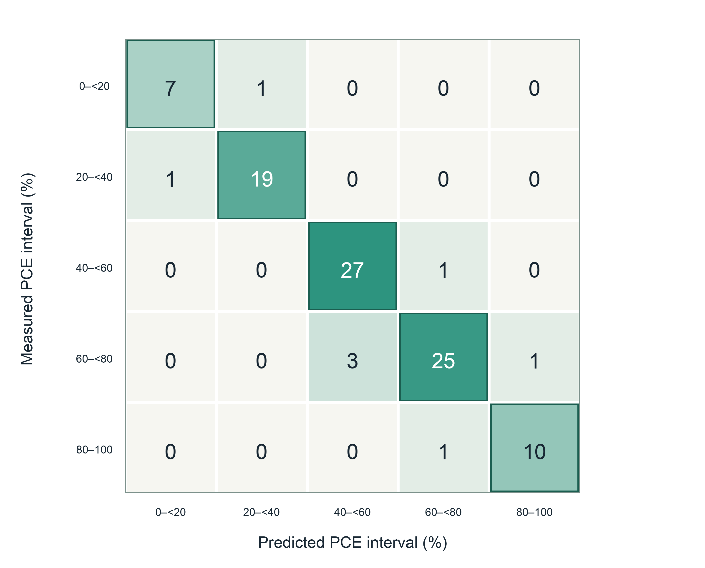

# Molecular Photothermal Conversion Efficiency Prediction

This package predicts photothermal conversion efficiency (PCE, %) from a molecular SMILES string. It includes the MPP graph neural network, an archived checkpoint, a labeled reference dataset, and five baseline regressors. The command-line tools support prediction, evaluation, and training.

[Installation](#installation) · [First prediction](#predict-pce) · [Figure 1 and checkpoint results](#graph-model-and-checkpoint) · [PDPP3T case study](#pdpp3t-case-study)

## Desktop demonstration

The recording shows how to enter a SMILES string and select a model in the desktop application. The desktop interface in the recording labels PCE as "Power Conversion Efficiency." The target documented for this project is **photothermal conversion efficiency**. The commands below run the model from the terminal.

<video controls width="900" poster="assets/demo_preview.jpg">
  <source src="assets/demo.mp4" type="video/mp4">
</video>

[](assets/demo.mp4)

[Open the recording](assets/demo.mp4)

## Installation

From the extracted project directory, create a Python 3.10–3.13 virtual environment and install the dependencies.

```bash
python3 -m venv .venv
source .venv/bin/activate
python -m pip install --upgrade pip
python -m pip install -r requirements.txt
```

For CUDA, install a PyTorch build compatible with your GPU driver. The default `--device auto` selects CUDA, Apple MPS, or CPU in that order. Use `--device cpu`, `--device cuda:0`, or `--device mps` to select a device explicitly.

The CPU examples below were verified on Apple silicon with macOS 15.5, Python 3.13.13, PyTorch 2.12.0, RDKit 2026.3.2, NumPy 2.4.6, and scikit-learn 1.9.0. The archive includes the weights and reference data needed for offline prediction after installation.

## Predict PCE

Run this example on the CPU to check the installation and archived checkpoint.

```bash
python predict.py --device cpu --smiles 'O=C1C2=C(C=CC=C2)C(/C1=C\C(C=C3)=CC=C3N(C4=CC=CC=C4)C5=CC=CC=C5)=C(C#N)\C#N'
```

For this example, the archived checkpoint returns approximately **38.38%** PCE and zero unknown features. The JSON output contains `smiles`, `predicted_pce_percent`, and `unknown_features`.

For batch prediction, supply one SMILES per line, without a header or PCE labels. This example takes two structures from the bundled data and writes the predictions to a CSV file.

```bash
awk 'NR <= 2 {print $1}' data/smiles_pce.txt > molecules.smi
python predict.py --device cpu --input molecules.smi --output outputs/predictions.csv
```

The two predicted values are approximately 38.38% and 35.75%, in input order. The CSV and terminal JSON contain the same fields. `predicted_pce_percent` is a raw regression estimate. The model takes molecular structure as its only input, so the same SMILES receives the same estimate across different formulations and irradiation conditions.

The default `--unknown-policy error` reports a local feature missing from the checkpoint vocabulary. With `--unknown-policy zero`, the model uses index 0 for each missing feature and reports the number of substitutions in `unknown_features`. A count of zero means that every feature matched the vocabulary. For the first example that count is zero, although the reference PCE is 1.9% and the prediction is 38.38%.

## Reference data

Each line in `data/smiles_pce.txt` contains a SMILES string and a measured PCE percentage separated by whitespace, with no header. Enter a measurement of 51.2% as `51.2`.

The original file contains 96 rows. Ten repeat an identical SMILES string and label, and ten contain disconnected fragments. The reference file retains 76 unique single-fragment SMILES strings in their original order. The loader checks that each structure parses in RDKit, each label is a finite number from 0 to 100, and repeated SMILES strings have consistent labels.

## Graph model and checkpoint


**Figure 1. Predicting photothermal conversion efficiency from polymer structure.** Panel **a** shows how atom and bond fingerprints are combined into a molecular representation for PCE regression. Panel **b** tracks loss, MAE, recall, and R² during training. The falling loss shows a closer fit to the training data. Panels **c–f** compare predicted and measured PCE for random forest, decision tree, gradient boosting, and the graph model. The dashed line marks exact agreement. Panel **f**, labeled “MMP Model” in the original figure, reports an MAE of 2.50 percentage points and an R² of 0.96 for the manuscript experiment.

Panel **a** labels the encoder “Molecular Feature Encoder” and the decoder “Attentive Extraction Decoder.” The packaged MPP implementation uses graph message passing, sum pooling, and a fully connected regression head. Its forward pass computes no attention weights.

RDKit adds explicit hydrogens to the molecular graph. The featurizer encodes element identity, aromaticity, and bond type. A radius-one Weisfeiler–Lehman update combines each atom with its bonded neighbors to produce a local fingerprint. The archived model embeds its 147 fingerprint identifiers in 50 dimensions, applies six message-passing layers, and sums the atom vectors for each molecule. Six fully connected hidden layers and a linear output layer map the molecular vector to a PCE estimate.

The weights in `checkpoints/mpp_model.pth` are byte-identical to the original archive file `2025-09-27-01-31-54-2000_1999.pth`. It contains parameter tensors only. The loader reconstructs the fingerprint vocabulary from the reference file in row order, so use the bundled `data/smiles_pce.txt` in its distributed order with this checkpoint. Pass a separate evaluation file to `evaluate.py --data`. Reproducing Figure 1f would require the original evaluation split, matching weights, and original fingerprint mapping.

| Metric | Archived checkpoint on the 76 packaged records |
|---|---:|
| Mean absolute error (MAE) | 34.18 percentage points |
| Root mean squared error (RMSE) | 44.37 percentage points |
| Coefficient of determination (R²) | −3.46 |

The negative R² means that predicting the mean measured PCE for all 76 records gives a smaller total squared error on these records. The reference-set replay therefore provides little support for using the distributed checkpoint to select molecules for synthesis.

### PDPP3T case study

The manuscript, desktop demonstration software, reference file, and CLI contain several PCE values associated with PDPP3T. Each comes from a different source.

| Source | PCE | Meaning |
|---|---:|---|
| Manuscript prediction / desktop GNN | 52.7% | The manuscript reports this prediction. The desktop application returns the stored value for an exact match to the PDPP3T SMILES. |
| Manuscript experiment | 51.8% | Measured for the PDPP3T-containing IPN formulation. |
| Packaged reference file | 51.2% | Label paired with this SMILES. The file contains no formulation or measurement metadata to establish its relationship to the 51.8% measurement. |
| Packaged CLI | 24.91% | Direct CPU inference with the distributed checkpoint and reconstructed vocabulary. |

```bash
python predict.py --device cpu --smiles 'CC(S1)=CC=C1C(N2CC(CCCCCCCC)CCCCCC)=C(C(C2=O)=C3C4=CC=C(C5=CC=C(C)S5)S4)C(N3CC(CCCCCCCC)CCCCCC)=O'
```

## Evaluate a checkpoint

Supply a labeled file in the same two-column format as the reference data.

```bash
python evaluate.py --data path/to/held_out.txt
```

The command reports the sample count, MAE, RMSE, R², and the total number of unknown-feature substitutions. To reproduce the reference-set calculation, use `--data data/smiles_pce.txt --device cpu`.

## Train a model

```bash
python train.py --data data/smiles_pce.txt --output checkpoints/trained_mpp.pth \
  --epochs 1000 --batch-size 16 --device auto
```

Training uses a seeded random validation split, mean squared error, the Adam optimizer, and early stopping. The script builds the fingerprint vocabulary from all supplied structures before splitting the records. With the defaults and bundled data, 68 records contribute to gradient updates and 8 to validation. For an independent evaluation, set aside test structures before passing data to `train.py`. The saved checkpoint contains the weights with the lowest validation loss, model settings, fingerprint vocabulary, and a training summary. Pass `--checkpoint checkpoints/trained_mpp.pth` to the prediction or evaluation command to use it.

| Option | Default | Meaning |
|---|---:|---|
| `--learning-rate` | `1e-4` | Adam learning rate |
| `--validation-fraction` | `0.1` | Fraction of records used for validation |
| `--patience` | `100` | Epochs without improvement before stopping |
| `--seed` | `1234` | Random seed for splitting and training |
| `--embedding-dim` | `50` | Fingerprint embedding dimension |
| `--hidden-layers` | `6` | Graph message-passing layers |
| `--output-layers` | `6` | Hidden layers in the regression head |
| `--radius` | `1` | Fingerprint neighborhood radius |

## Compare the baselines

```bash
python baselines.py
python baselines.py --full
```

Both commands run 10-fold cross-validation for random forest, support vector regression, decision tree, gradient boosting, and k-nearest neighbors. They encode each SMILES character by its ASCII value and right-pad shorter strings with 30. The output gives out-of-fold MAE and R² for each model. The default uses 500 estimators for random forest and gradient boosting. The `--full` setting uses 10,000.

## Archived agreement matrix

Rows group measured PCE and columns group predicted PCE. Of the 96 records in the archived figure, 88 fall on the diagonal (91.7% agreement across five intervals of 20 percentage points). This measures agreement within bins. Two values on opposite sides of a bin edge can be close in PCE and still count as a mismatch. The matrix uses the original prediction set, separate from the 76-record checkpoint evaluation above.



[Open the vector figure](docs/figures/mpp_binned_agreement_matrix_5bins.svg)

## Package contents

| Path | Contents |
|---|---|
| `predict.py`, `evaluate.py`, `train.py` | Graph model command-line entry points |
| `baselines.py` | Cross-validation for the five baseline models |
| `mpp/data.py`, `mpp/features.py` | Data validation, graph construction, and fingerprint vocabulary |
| `mpp/model.py`, `mpp/checkpoint.py` | Model architecture, batching, device selection, and checkpoint handling |
| `data/`, `checkpoints/` | Reference SMILES and archived model weights |
| `assets/`, `docs/figures/` | Desktop recording, preview, manuscript Figure 1, and archived agreement matrix |
| `requirements.txt`, `tests/` | Python dependencies and unit tests |

## Run the tests

```bash
python -m unittest discover -s tests -v
```

The suite covers data parsing, conflicting labels, invalid and disconnected SMILES, unknown fingerprints, graph dimensions, and batched model output.
